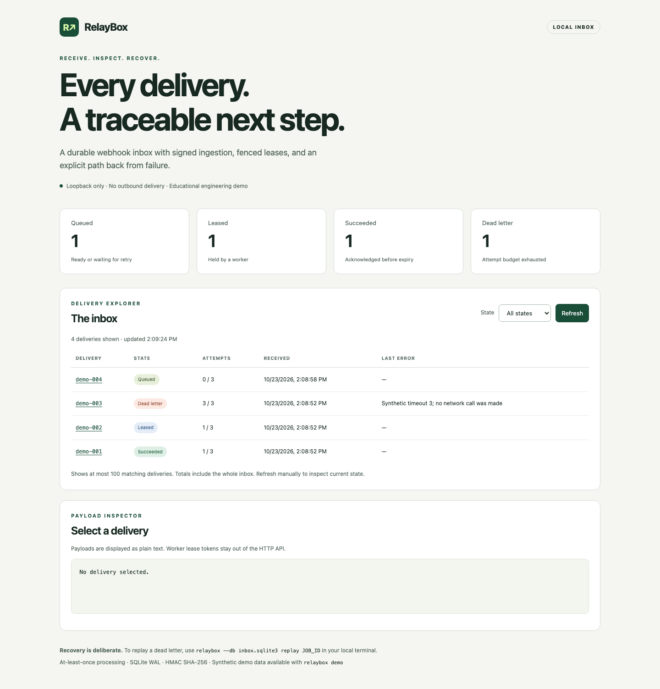

# RelayBox

[](https://github.com/ult666666/relaybox/actions/workflows/ci.yml)

**A signed webhook inbox you can inspect, retry, and recover locally.**

RelayBox is a Python 3.11+ engineering demo built with the standard library and SQLite. It receives authenticated JSON deliveries, deduplicates by delivery ID **and exact payload digest**, and exposes a small durable job state machine. An accessible dashboard makes queued work, active leases, successful acknowledgments, and dead letters visible.

No runtime dependencies, external services or outbound webhook delivery. This is an educational portfolio project built with AI assistance, not a production service; see [Limits that matter](#limits-that-matter).



## Run in a minute

From a checkout, no installation is necessary:

```bash
python3 -m relaybox --db .local/demo.sqlite3 demo
python3 -m relaybox --db .local/demo.sqlite3 serve --demo-secret
```

Open **http://127.0.0.1:8787**. If that port is occupied, add `--port 8797` to the serve command and open the matching port. The demo seeds one delivery in each state, using visibly synthetic English/Mandarin payloads. It refuses to overwrite a nonempty database. Choose a new database path to start another demo. Stop the server with Ctrl+C.

The `--demo-secret` key is public: `relaybox-synthetic-demo-secret-only`. It is appropriate only for synthetic local data. For your own local experiment, set `RELAYBOX_SECRET` to a random value of at least 16 bytes and omit that flag. Keep database files in a private directory.

To install the CLI in an isolated environment:

```bash
python3 -m venv .venv
.venv/bin/python -m pip install .
.venv/bin/relaybox --help
.venv/bin/relaybox --db .local/installed.sqlite3 demo
```

PowerShell users can use `.venv\Scripts\python.exe` and `.venv\Scripts\relaybox.exe`. Building uses the exact setuptools version in `pyproject.toml`; the running application uses only Python's standard library. No PyPI release is implied.

## Send a signed delivery

With the demo server running on its default port 8787, run this in another terminal from the checkout. The client sends only to that fixed loopback address:

```bash
python3 examples/send_webhook.py
```

Expected result: HTTP `202` with `created: true`, then HTTP `200` for the identical repeat. Reusing that ID with different bytes returns `409`. Click **Refresh** on the dashboard to see the new delivery.

For any UTF-8 JSON object file, obtain signing headers with:

```bash
python3 -m relaybox sign example-001 examples/payload.json --demo-secret
```

Send those headers and the **unchanged file bytes** to `POST /webhooks` within five minutes. The signature covers `timestamp + "." + delivery_id + "." + raw_body`. Signing the ID prevents a valid body/signature from being reused under another delivery ID. See the full [HTTP contract](docs/API.md).

## Work and recover

Process ready synthetic deliveries into local JSON receipts:

```bash
python3 -m relaybox --db .local/demo.sqlite3 work --receipts .local/receipts --max-jobs 10
```

The worker claims at most 10 jobs and stops as soon as none is ready; it does not wait for future retries. Each written receipt is acknowledged, and a handler failure follows the retry and dead-letter policy. It prints a summary such as `{"claimed":1,"succeeded":1,"failed":0,"lost_leases":0}`. Defaults: `--max-jobs 1` (up to 1000), `--worker local-worker` and `--lease-seconds 30`.

Each receipt holds a format version, the delivery ID, the SHA-256 digest of the original body and the parsed payload. Its filename hashes the delivery ID with the body digest, so path-like IDs cannot escape the directory. Running a job again finds the identical receipt and succeeds without rewriting it; a conflicting or corrupt receipt fails instead of being overwritten. This shows local idempotency only, with no distributed exactly-once or power-loss guarantee. See the [receipt format and file-safety rules](docs/API.md#local-worker-library-and-receipt-format).

For manual ownership and recovery:

```bash
python3 -m relaybox --db .local/demo.sqlite3 list --state dead_letter
python3 -m relaybox --db .local/demo.sqlite3 replay 3
python3 -m relaybox --db .local/demo.sqlite3 claim --worker local-reviewer --lease-seconds 30
```

The claim response includes a private `lease_token`. Complete the claimed ID with that token before expiry:

```bash
# Extend a still-current lease before expiry (same token, no new attempt):
python3 -m relaybox --db .local/demo.sqlite3 renew JOB_ID --token TOKEN --lease-seconds 60
python3 -m relaybox --db .local/demo.sqlite3 ack JOB_ID --token TOKEN
# Or record a failure; this schedules a retry or ends in dead_letter:
python3 -m relaybox --db .local/demo.sqlite3 fail JOB_ID --token TOKEN --error "Synthetic local failure"
```

- Commands print JSON and exit `0` on success, or `2` for invalid arguments and failed operations. `work` exits `1` if a handler failed or a lease was lost.
- An empty claim succeeds and returns `{"job": null}`.
- `replay` only accepts dead letters, and each replay resets the attempt budget.
- Worker operations stay in the CLI and library, so the dashboard cannot change jobs.

## Understand an idle worker

Version 0.4.0 adds a read-only operations summary. Use Refresh in the dashboard, or GET `/api/metrics` from the local server, to tell queued work that is ready now from delayed retries, and active leases from expired ones. The four state cards still show persisted totals: an expired lease with no attempts left stays in **Leased** until a worker's next claim moves it to dead letter. Viewing diagnostics never claims or changes a job.

The oldest ready wait is the time since a job became ready (`available_at`), not the time since ingestion. The dashboard rounds it, for example `About 4.6 seconds since ready`, and the API keeps exact seconds. Refresh is manual. If one section fails to load, it shows an error and the other keeps working.

Library users can call `inbox.metrics()` on an existing `Inbox`. It returns a read-only, local diagnostic snapshot: its query can scan every row, but never selects payloads or private job fields. See the [exact metrics contract](docs/API.md#queue-metrics).

To inspect that scan cost, use the source-only [local measurement tool](docs/PERFORMANCE.md). It checks a fixed synthetic workload against an independent oracle, then retains raw installed-library call timings and environment metadata. No production capacity or timing threshold is implied.

## Back up and drill recovery

Version 0.3.0 adds consistent local SQLite snapshots. Never copy just a live inbox's main file: committed jobs may still be in its WAL. Choose an existing trusted private directory and fresh destination names:

```bash
python3 -m relaybox --db .local/demo.sqlite3 backup .local/snapshot.sqlite3 --timeout 10
python3 -m relaybox verify-backup .local/snapshot.sqlite3
```

`backup` prints a JSON receipt with the paths, schema version, integrity result, job counts, SHA-256 and file size; it never includes payloads or lease tokens. The **snapshot itself contains all data, including tokens and payloads**, so protect it like the original. A backup includes committed WAL data, leaves out uncommitted changes, and refuses to overwrite any existing path.

Before switching to a restored path, **stop the original service and every original worker**. Keep the original stopped during the drill. Restore to a new name; do not initialize that destination first:

```bash
python3 -m relaybox --db .local/recovered.sqlite3 restore .local/snapshot.sqlite3
python3 -m relaybox --db .local/recovered.sqlite3 stats
python3 -m relaybox --db .local/recovered.sqlite3 work --receipts .local/receipts --max-jobs 10
```

Compare the restored counts with the saved backup receipt before processing work. Attempts, retry policy, replay counts and leases survive exactly, and the next claim reclaims or dead-letters any expired lease. Keep the receipt directory as well, because the database backup does not include it, and expect work done after the snapshot to repeat. There is no cross-database exactly-once guarantee.

Backups support trusted, operator-owned RelayBox databases up to 1 GiB, with a deadline of 0.1 to 60 seconds (default 10). `verify-backup` needs a standalone snapshot that nothing is writing to, so run `backup` first for a live inbox. See the [complete contract](docs/API.md#backup-and-recovery-contract) for the file-safety rules and platform limits.

After installing, `python examples/verify_backup.py` performs an isolated synthetic backup → verify → restore → expired-lease receipt drill outside the checkout.

## Library API

```python
from relaybox.store import Inbox
from relaybox.worker import ReceiptHandler, run_worker

inbox = Inbox("inbox.sqlite3", max_attempts=3, base_delay=2, max_delay=60)
job, created = inbox.ingest("example-001", b'{"synthetic":true}')
summary = run_worker(inbox, ReceiptHandler("receipts"), max_jobs=10)
print(summary)

# Or pass your own local idempotent handler:
inbox.ingest("example-002", b'{"synthetic":true}')
def handle(job):
    print(job["payload"]["synthetic"])
    # Before a long phase, while ownership is still valid:
    inbox.renew(job["id"], job["lease_token"], lease_seconds=60)

run_worker(inbox, handle, worker="example-worker", lease_seconds=30)
```

`ingest` validates content but does not authenticate a sender; HMAC verification happens at the HTTP boundary, and library and CLI access is trusted local access. A handler returns normally to acknowledge the job or raises an `Exception` to fail it. There is no automatic lease renewal or handler timeout, so a long handler must call `renew` before its lease expires. External side effects still need their own idempotency. See the [worker library contract](docs/API.md#local-worker-library-and-receipt-format).

## Inspect the engineering

Start with [`store.py`](relaybox/store.py) for atomic `BEGIN IMMEDIATE` claims and token checks, then [`tests/test_store.py`](tests/test_store.py) for real multi-connection contention and expired-worker rejection. [`tests/test_http.py`](tests/test_http.py) exercises live TCP requests, malformed framing, size limits, clock checks, hostile content, and JSON error responses.

```bash
python3 -m unittest discover -v
```

CI runs this suite on Python 3.11 and 3.13, then installs the package and runs the installed CLI, worker and backup checks from outside the checkout. A separate job checks the installed dashboard in Chromium with the tooling in [`browser/`](browser/README.md). To repeat the installed checks, run `python examples/verify_install.py`, `python examples/verify_worker.py` and `python examples/verify_backup.py` with the installed environment's interpreter. Read [what CI verifies](docs/VERIFICATION.md), [architecture](docs/ARCHITECTURE.md), [API](docs/API.md), or the [中文指南](docs/GUIDE.zh-CN.md).

## Limits that matter

- **Local only:** IPv4 loopback, plain HTTP, one shared HMAC key; no account authentication, key rotation, multi-tenant permissions, or TLS deployment configuration. Any process/user with local HTTP access can read payloads.
- **At least once:** a lease can expire during work. Tokens fence acknowledgments in this SQLite database; they cannot undo or prevent external side effects. Consumers need their own idempotency strategy.
- **Small scope:** 64 KiB JSON objects, 32 active HTTP handlers, three-second socket read timeout, 10-second SQLite busy timeout. The local worker bounds claims, not handler runtime. No outbound delivery, rate quotas, background scheduler, automatic lease renewal, or distributed worker coordination.
- **Recovery requires activity:** expiry is reconciled on the next claim. The dashboard reports persisted state and may show an expired lease until a worker polls.
- **Storage is bounded only by your disk:** no retention, encryption at rest, automatic backups, migrations beyond schema version 1, payload search, or full audit history. The dashboard shows the latest 100 matches; the API allows up to 500.
- **Demonstration only:** synthetic data and local checks. No production use, capacity benchmark or independent security audit.

See [SECURITY.md](SECURITY.md) and [CONTRIBUTING.md](CONTRIBUTING.md). Licensed under [MIT](LICENSE).
