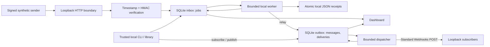
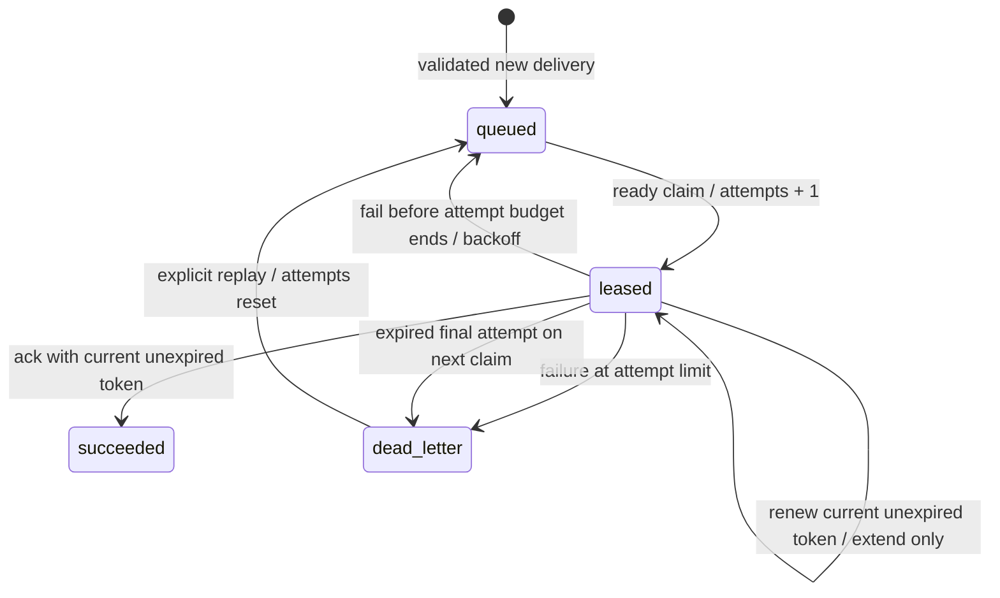

# Architecture

RelayBox makes ingestion identity, worker ownership and outbound delivery explicit. The runtime is entirely Python's standard library: `http.server`, `http.client`, `hmac`, `hashlib`, `sqlite3`, and a static HTML/CSS/JavaScript dashboard. It is a local learning project rather than a hosted delivery platform.

## Delivery identity

The HTTP boundary bounds the body and rejects ambiguous framing before ingesting. Required headers identify the delivery, canonical Unix timestamp, and MAC. The MAC binds all three: `ASCII(timestamp) + b"." + ASCII(delivery_id) + b"." + raw_body`. Acceptance allows a symmetric five-minute clock window, so replay prevention is the combination of timestamp freshness and a unique delivery identifier.

`ingest` parses a finite UTF-8 JSON object, rejecting duplicate keys, invalid Unicode, nonfinite numbers and excessive nesting. It hashes the exact raw bytes. A transaction checks the unique `delivery_id`: same digest means the existing job is returned; a changed digest means conflict. JSON whitespace differences count as different bytes. Delivery IDs have no automatic expiry, so deduplication lasts as long as the row is retained.

## State and ownership

Each operation opens a separate SQLite connection with WAL mode, full synchronous commits, and a ten-second busy timeout. Mutations use `BEGIN IMMEDIATE`, serializing competing writers before selecting and changing a candidate. Time is sampled after the write transaction is acquired, so waiting behind another writer does not consume a newly granted lease, validate an expired completion against an old clock sample, or backdate ingestion/replay/retry timestamps. A claim selects one eligible row and creates a cryptographically random token and expiry in the same transaction. Concurrent workers cannot claim the same current lease.

Acknowledgment and failure check **state + token + unexpired lease** in a write transaction. A reclaimed job gets a fresh token. Old workers are rejected even if they finish after the new claim; an expired worker is also rejected before any reclaim. Fencing only protects this database. Processing remains at least once, and any consumer side effect must be idempotent or independently fenced.

Renewal applies the same state/token/expiry checks under `BEGIN IMMEDIATE`, sampling time only after lock acquisition. It sets expiry to `max(existing expiry, now + requested duration)` without changing worker, token, or attempts. Completion and renewal serialize; a completed job cannot be revived. Exact expiry fails renewal. Workers needing more time must arrange explicit renewal before expiry; no background thread renews on their behalf.

Retries use `min(max_delay, base_delay × 2^(attempts−1))`, defaulting to 2, 4, … seconds with a 60-second cap. Attempts count claims, including expired leases. At the default budget of three claims, the final failure or next poll after a final expired lease yields `dead_letter`. Policy values are stored per job, so opening a database with a differently configured `Inbox` does not change old deliveries. An explicit replay resets attempts and records `replay_count`; it may be requested repeatedly by the trusted local operator.

No scheduler runs in the background. `available_at` gates future claims; another call to `claim` is required to take work or reconcile expired final leases. Dashboard counts reflect persisted state, not speculative timer transitions.

## Outbound delivery

Outbound delivery follows the [Standard Webhooks 1.0.0 specification](https://github.com/standard-webhooks/standard-webhooks/blob/main/spec/standard-webhooks.md). It adds four tables in schema version 2:

- `subscriptions`: endpoint URL, a sorted JSON list of event types (`*` matches all), and `active` or `disabled` state.
- `subscription_secrets`: raw 24–64 byte keys with an optional expiry. The newest key has no expiry; older keys expire when their rotation grace period ends.
- `messages`: the `webhook-id`, event type, raw body bytes and their SHA-256 digest.
- `deliveries`: one row per message and subscription, with the same lease and retry columns as `jobs` plus the last HTTP status.

`publish` stores the message and its deliveries in one `BEGIN IMMEDIATE` transaction, so a crash never leaves a message with only some of its deliveries. The `webhook-id` is the idempotency key: the same ID with the same type and bytes returns the existing message and queues nothing; different content is a conflict. Only subscriptions active at publish time get deliveries. `relay` derives the ID from the inbound delivery ID and body digest (`msg_` plus the first 32 hex digits of SHA-256), so re-running the relay handler after a lost inbound lease queues nothing new.

### One lease state machine for two tables

`store.LeaseQueue` holds the claim, renew, complete and replay transactions, written once with the table name as a fixed class constant. `Inbox` uses it for `jobs` and `Outbox` for `deliveries`, so outbound delivery inherits the inbox's properties: time is sampled after the write lock is acquired, a claim is one atomic `BEGIN IMMEDIATE` transaction with a fresh 256-bit token, completion requires the current unexpired token, an expired final lease becomes a dead letter on the next claim, and replay resets the attempt budget. The two tables differ only in how a failure is scheduled and in what a claim returns. A delivery claim joins the message body, endpoint and the keys active at that moment.

### Signing

Each attempt signs `webhook-id + "." + webhook-timestamp + "." + body` with HMAC-SHA256 and sends `v1,` plus the base64 digest. The `webhook-id` is the message's and never changes across retries or replays; `webhook-timestamp` is the attempt time, as the specification requires, so each attempt carries fresh signatures. While a rotation's grace period lasts, the header carries one space-separated signature per active key, newest first, and a receiver accepts the request if any one matches. Secrets use the specification's `whsec_` plus base64 form and its 24–64 byte range; generated keys have 32 random bytes. The implementation reproduces the specification's published test vector (`v1,g0hM9SsE+OTPJTGt/tmIKtSyZlE3uFJELVlNIOLJ1OE=`, from the reference libraries' `test_sign_function`). `relaybox.standard_webhooks.verify` is a receiver-side check with a symmetric 300-second timestamp window and constant-time comparison.

### One attempt

`dispatch.send` uses `http.client` rather than `urllib`, because `urllib` follows redirects and reads proxy settings from the environment. Every attempt is bounded three ways. The socket timeout bounds connecting and each read. A watchdog thread shuts the socket down when the wall-clock deadline passes, so a receiver that trickles one byte at a time cannot keep the attempt open. The body read stops after 4 KiB (configurable up to 64 KiB). Once a status line arrives, it decides the outcome even if the body read then fails.

| Response | Outcome | Why |
|---|---|---|
| 2xx | success | The specification defines success as any 2xx. |
| 408, 429 | retry | Request Timeout and Too Many Requests describe a temporary condition ([RFC 9110 §15.5.9](https://www.rfc-editor.org/rfc/rfc9110#section-15.5.9), [RFC 6585 §4](https://www.rfc-editor.org/rfc/rfc6585#section-4)). |
| 5xx | retry | Server errors are usually temporary. |
| 410 | dead letter, subscription disabled | The specification asks senders to stop sending to an endpoint that answers 410 Gone. |
| other 4xx | dead letter | The same request would fail again. |
| 3xx | dead letter | Redirects are never followed; the specification recommends updating the URL instead. |
| other status (1xx, 600–999) | retry | An unexpected answer is treated like a server error. |
| timeout, refused, reset, closed early, malformed response, TLS failure | retry | Network failures are usually temporary. |

A disabled subscription, a target refused by the URL rules, or a subscription without an active key dead-letters the delivery without sending a request.

### Retry schedule

A retry waits `uniform(0, min(max_delay, base_delay × 2^(attempts−1)))` seconds. This is the "full jitter" variant described in [Exponential Backoff And Jitter](https://aws.amazon.com/blogs/architecture/exponential-backoff-and-jitter/): the random spread keeps many deliveries that failed at the same moment, for example during one receiver outage, from all retrying at the same moment. A `Retry-After` header, as delay-seconds or an HTTP-date ([RFC 9110 §10.2.3](https://www.rfc-editor.org/rfc/rfc9110#section-10.2.3)), raises the wait to at least the requested time, capped at `max_delay`. It is honoured only on retryable responses. Policy values are stored per delivery at fan-out, like jobs. The default random source is `random.SystemRandom`, so dispatchers started by `fork` never share a jitter sequence; tests inject a seeded generator.

### Crashes, leases and duplicates

Delivery is at least once. If a dispatcher dies after the receiver processed a request but before the result was recorded, its lease expires and the next claim sends the message again with the same `webhook-id`. A dispatcher whose lease expired cannot record its late result, because completion checks the token. Receivers should therefore treat `webhook-id` as an idempotency key, as the specification recommends. `run_dispatcher` requires `lease_seconds > timeout`, so an attempt that runs to its deadline still finishes inside its lease and no renewal thread is needed. The exception is a completion that waits for SQLite's write lock: if that wait outlasts the lease, the result is rejected and the message is sent again.

### Targets

By default the URL host must be a literal loopback address (`127.0.0.0/8` or `::1`, including the IPv4-mapped form). Names, including `localhost`, are refused, so no DNS answer can send a default-mode delivery elsewhere. URLs with credentials, fragments, port 0 or characters outside printable ASCII are refused. A non-loopback host needs `allow_remote` (the `--allow-remote` flag) and `https://`, which uses `ssl.create_default_context()` with certificate and hostname verification. The check runs when the subscription is created and again before every attempt, so a URL edited directly in the database is still checked. Subscriptions are created only through the trusted local CLI or library, never over HTTP.

### Dashboard replay

The dashboard lists deliveries through `GET /api/deliveries`, which returns summaries and whole-table counts from one read transaction and never includes bodies, tokens or secrets. Replay is the dashboard's only state change and is off unless `serve` runs with `--allow-replay`. The `POST /api/deliveries/ID/replay` route then requires the server's own `Origin`, `Sec-Fetch-Site: same-origin` when the header is present, `Content-Type: application/json` and an empty body. A cross-site page cannot forge that `Origin`, and the JSON content type forces a CORS preflight that the server never approves.

### Schema version 2

Opening any version-0 or version-1 file with this release creates the missing outbound tables and sets `user_version` to 2 in one transaction; jobs are untouched. Releases before 0.5.0 refuse a version-2 file with "unsupported database schema version". Backup and verification accept both versions. The expected structure for each version is built by running RelayBox's own schema statements in a private in-memory database, never SQL read from the source file, and the version-1 `jobs` columns are also pinned separately. Version-2 receipts add outbound counts, and verification also runs SQLite's `foreign_key_check`.

### Outbound trade-offs

Delivery runs as a bounded command (`deliver`, optionally with `--wait`), not a background service. Only each delivery's latest status and error are kept; there is no attempt history table. There is no per-endpoint concurrency cap, rate limit or circuit breaker, so one slow endpoint delays the deliveries behind it in a single dispatcher. Fan-out is decided at publish time. The [endpoint verification extension](https://github.com/standard-webhooks/standard-webhooks/blob/main/spec/extensions/endpoint-verification.md) and asymmetric `v1a` signatures are not implemented, and inbound ingestion still uses RelayBox's own `X-RelayBox-*` HMAC scheme.

## Queue diagnostics

`Inbox.metrics` samples the supplied clock once and validates finite Unix seconds in 0–253402300799 inclusive. A single SELECT aggregates the four persisted states, queued readiness/delay, active/expired lease partitions, oldest queued-ready wait, minimum future retry and minimum active lease expiry. Exact readiness is `available_at <= now`; exact expiry is `lease_until <= now`. The same statement supplies every count/time from one SQLite snapshot while other WAL connections can commit. No payload, identity, digest, token, worker or error column is selected. Result memory is fixed in size, but SQL work may scan every row; no throughput claim follows.

Diagnostics does not call claim or mutate rows. Expired exhausted leases stay in the leased total until a normal claim reconciles them. Oldest-ready wait starts at available_at, not creation; absent waits/dates are explicit nulls. A clock-only change can alter derived partitions with every stored field unchanged. Normal Inbox construction retains its existing database creation/WAL behavior, separate from the metrics SELECT. This is a local snapshot and sampled clock, not continuous monitoring, distributed time, completion assurance or health certification.

The HTTP endpoint returns exactly the object through the usual boundary. Dashboard state cards and an accessible operations definition list share that metrics response; the bounded delivery list is a separate request and is labeled accordingly. Refresh is manual. Successful sections render independently; loading/failed metrics clear old cards/times and report status, while list failure clears list rows without discarding successful metrics. The Refresh button stays focusable with an accessible busy indicator, and both refresh and detail generation guards prevent older responses replacing newer UI state. Dates render in the browser's local timezone, nulls have descriptive markers, and all untrusted text uses textContent. The oldest-ready wait is rounded only in the browser (`About 4.6 seconds since ready`); the API keeps exact seconds, and an invalid wait goes through the metrics error state rather than being shown. Development Chromium checks in `browser/`, also run as a CI job, drive the installed wheel with a supplied-clock fixture and separately labeled controlled responses; no browser library enters the runtime package.

## Bounded local processing

`run_worker` validates configuration, then processes up to 1–1000 claims through a caller-supplied handler. It stops immediately at no ready work, including when retries are delayed. Handler return attempts ack; a normal exception attempts fail under the stored policy. A rejected ack/fail increments `lost_leases` instead of changing another owner's job. Other inbox storage/I/O failures propagate. KeyboardInterrupt/SystemExit leave the current lease to expire. The bound controls claims, not handler execution time; external side effects and long-handler renewal remain caller responsibilities.

The CLI uses only `ReceiptHandler`; it cannot load arbitrary handlers or execute shell commands. A receipt's hashed filename combines delivery identity and raw body digest, independent of database-local job IDs. Canonical versioned JSON includes only delivery ID, digest and parsed synthetic payload. Repeating the same effect after an expired claim or from another database succeeds only if its exact bytes already exist. Any other contents fail without overwrite. A fully written/fsynced temporary file is hard-linked to its final name atomically, then removed. This supports concurrent identical publications while preventing partial final files. Details are in the [receipt contract](API.md#local-worker-library-and-receipt-format).

The local receipt directory and parents must be trusted against concurrent replacement. Ancestor aliases are canonicalized, the selected directory itself cannot be a symlink, and existing nonregular/symlink receipts are rejected. New directories/files request private POSIX permissions; existing permissions are not altered. Hard-link support is required. The filesystem effect and SQLite acknowledgment have no shared transaction. A process crash after publication may repeat the handler, which accepts the identical retained receipt. A hard kill can leave temporary files; directory metadata is not fsynced and power-loss durability is unverified. Deleting/editing receipts defeats this demonstration idempotency; it is not a distributed exactly-once protocol.

## Consistent snapshots and recovery

`backup.py` opens a regular, existing source read-only and recognizes the unchanged schema 1 through an explicit table/index declaration allowlist plus column structure, integrity and state checks. It pins a read transaction before collecting metadata, so online backup pages and counts refer to the same committed snapshot even when a separate WAL writer commits during copying. Uncommitted changes are excluded. Copying the main file of a live WAL database would lose this property and is never used.

The online backup API copies 64 pages per step into a private, exclusive same-directory temporary file. The destination is finalized into standalone DELETE journal mode and closed; its read-only validation/counts must match the pinned source metadata. The completed file is hashed/fsynced and published by an exclusive atomic hard link. Existing destination paths or SQLite sidecars fail without overwrite/deletion. Ordinary failures clean temporary files and sidecars. Verification first reads the bounded 100-byte SQLite header and rejects WAL mode before a SQLite connection can create source WAL/SHM files; `mode=ro` alone does not prevent those side effects. It remains read-only and requires a quiescent standalone snapshot; restore reuses the safe copier into a new path without constructing `Inbox` first. Successful JSON receipts contain only paths, schema/integrity, counts, SHA-256 and size; the actual backup retains every database field, including secrets.

A shared finite 0.1–60 second monotonic deadline applies to SQLite busy waits, VM progress, backup progress and streamed hashing; source databases above 1 GiB are refused before full validation/copy. The deadline is cooperative and cannot interrupt a filesystem syscall. Operator-owned local databases/directories are the supported trust level. No extensions, arbitrary SQL from a file, migrations or repairs are executed; SQLite still parses files, so malformed-file rejection is not a hostile-input sandbox. Ancestor aliases are resolved, selected symlinks are refused, and directories must not be concurrently replaced. Hard-link support is required. There is no Windows ACL certification, final-directory fsync, power-loss guarantee or hard-kill cleanup guarantee.

A restored copy preserves tokens, attempts, retry policies and replay state, but is an independent database. Stop the original service and all workers before switching paths; copied tokens cannot fence original-database workers. Claims perform the usual expired-lease reconciliation. Work after the snapshot may repeat; retained receipt files and external side-effect idempotency remain separate responsibilities. Database backups do not include the receipt directory. The installed recovery drill demonstrates an expired pre-ack lease reusing its identical retained receipt, not a distributed exactly-once guarantee.

The design follows the official [Python 3.11 backup contract](https://docs.python.org/3.11/library/sqlite3.html#sqlite3.Connection.backup), [SQLite online backup contract](https://www.sqlite.org/backup.html), and [SQLite sidecar recovery behavior](https://www.sqlite.org/tempfiles.html). See the [API contract](API.md#backup-and-recovery-contract) for exact limits.

## HTTP and browser boundary

The server binds only to `127.0.0.1`; arbitrary external binding is refused. Host and Origin checks and Fetch Metadata rejection reduce DNS rebinding and cross-site access. They are boundary defenses, not local user authentication. Any local process can read dashboard/API payloads.

Requests are closed after one response. Bodies require a single canonical `Content-Length`, are bounded at 65,536 bytes, and have a three-second socket read timeout. Compressed bodies, chunked framing, duplicate important headers and unsupported methods are rejected. The server caps active handlers at 32. These are per-read socket limits, not an absolute end-to-end deadline, and are not a substitute for an internet-facing HTTP server. SQLite contention and disk errors return `503` without database details.

The HTTP API does not expose lease tokens or signing secrets. Claim/renew/ack/fail/replay, the local worker and the dispatcher require trusted filesystem access through CLI/library calls. The one exception is the opt-in outbound dead-letter replay route described above. The dashboard uses DOM `textContent`, displays untrusted payloads as text, includes labeled filters and semantic tables, supports keyboard interaction and narrow screens, and sends a restrictive Content Security Policy. No CDN, external font, telemetry or browser runtime dependency is used.

## Deliberate tradeoffs

SQLite keeps the state machine inspectable and portable, at the cost of serial writes and a single local file. Wall-clock leases are easy to inspect but assume a stable local clock; clock jumps can shorten or extend ownership. A single random token is sufficient for database fencing, but is not an ordered counter for external resources. There is no retention, migration beyond the additive version-2 upgrade, automatic lease renewal for inbound handlers, dead-letter audit trail, remote worker API, exactly-once guarantee or scale claim.

Tests exercise real files and connections, live HTTP sockets, command subprocesses, and a synthetic demo. Browser interaction verification is documented separately in [VERIFICATION.md](VERIFICATION.md). AI assistance was used for implementation and testing; the evidence does not represent an independent security audit.
