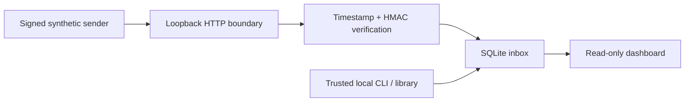

# Architecture

RelayBox makes ingestion identity and worker ownership explicit. The runtime is entirely Python's standard library: `http.server`, `hmac`, `hashlib`, `sqlite3`, and a static HTML/CSS/JavaScript dashboard. It is a local learning project rather than a hosted delivery platform.

## Delivery identity

The HTTP boundary bounds the body and rejects ambiguous framing before ingesting. Required headers identify the delivery, canonical Unix timestamp, and MAC. The MAC binds all three: `ASCII(timestamp) + b"." + ASCII(delivery_id) + b"." + raw_body`. Acceptance allows a symmetric five-minute clock window, so replay prevention is the combination of timestamp freshness and a unique delivery identifier.

`ingest` parses a finite UTF-8 JSON object, rejecting duplicate keys, invalid Unicode, nonfinite numbers and excessive nesting. It hashes the exact raw bytes. A transaction checks the unique `delivery_id`: same digest means the existing job is returned; a changed digest means conflict. JSON whitespace differences count as different bytes. Delivery IDs have no automatic expiry, so deduplication lasts as long as the row is retained.

## State and ownership

Each operation opens a separate SQLite connection with WAL mode, full synchronous commits, and a ten-second busy timeout. Mutations use `BEGIN IMMEDIATE`, serializing competing writers before selecting and changing a candidate. A claim selects one eligible row and creates a cryptographically random token and expiry in the same transaction. Concurrent workers cannot claim the same current lease.

Acknowledgment and failure check **state + token + unexpired lease** in a write transaction. A reclaimed job gets a fresh token. Old workers are rejected even if they finish after the new claim; an expired worker is also rejected before any reclaim. Fencing only protects this database. Processing remains at least once, and any consumer side effect must be idempotent or independently fenced.

Retries use `min(max_delay, base_delay × 2^(attempts−1))`, defaulting to 2, 4, … seconds with a 60-second cap. Attempts count claims, including expired leases. At the default budget of three claims, the final failure or next poll after a final expired lease yields `dead_letter`. Policy values are stored per job, so opening a database with a differently configured `Inbox` does not change old deliveries. An explicit replay resets attempts and records `replay_count`; it may be requested repeatedly by the trusted local operator.

No scheduler runs in the background. `available_at` gates future claims; another call to `claim` is required to take work or reconcile expired final leases. Dashboard counts reflect persisted state, not speculative timer transitions.

## HTTP and browser boundary

The server binds only to `127.0.0.1`; arbitrary external binding is refused. Host and Origin checks and Fetch Metadata rejection reduce DNS rebinding and cross-site access. They are boundary defenses, not local user authentication. Any local process can read dashboard/API payloads.

Requests are closed after one response. Bodies require a single canonical `Content-Length`, are bounded at 65,536 bytes, and have a three-second socket read timeout. Compressed bodies, chunked framing, duplicate important headers and unsupported methods are rejected. The server caps active handlers at 32. These are per-read socket limits, not an absolute end-to-end deadline, and are not a substitute for an internet-facing HTTP server. SQLite contention and disk errors return `503` without database details.

The HTTP API does not expose lease tokens. Claim/ack/fail/replay require trusted filesystem access through CLI/library calls. The dashboard uses DOM `textContent`, displays untrusted payloads as text, includes labeled filters and semantic tables, supports keyboard interaction and narrow screens, and sends a restrictive Content Security Policy. No CDN, external font, telemetry or browser runtime dependency is used.

## Deliberate tradeoffs

SQLite keeps the state machine inspectable and portable, at the cost of serial writes and a single local file. Wall-clock leases are easy to inspect but assume a stable local clock; clock jumps can shorten or extend ownership. A single random token is sufficient for database fencing, but is not an ordered counter for external resources. There is no retention, automated migration, lease extension, dead-letter audit trail, remote worker API, outbound delivery, exactly-once guarantee or scale claim.

Tests exercise real files and connections, live HTTP sockets, command subprocesses, and a synthetic demo. Browser interaction verification is documented separately in [VERIFICATION.md](VERIFICATION.md). AI assistance was used for implementation and testing; the evidence does not represent an independent security audit.
