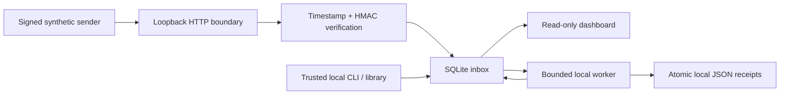
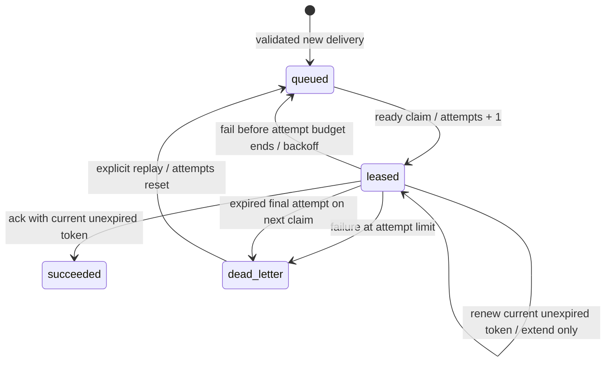

# Architecture

RelayBox makes ingestion identity and worker ownership explicit. The runtime is entirely Python's standard library: `http.server`, `hmac`, `hashlib`, `sqlite3`, and a static HTML/CSS/JavaScript dashboard. It is a local learning project rather than a hosted delivery platform.

## Delivery identity

The HTTP boundary bounds the body and rejects ambiguous framing before ingesting. Required headers identify the delivery, canonical Unix timestamp, and MAC. The MAC binds all three: `ASCII(timestamp) + b"." + ASCII(delivery_id) + b"." + raw_body`. Acceptance allows a symmetric five-minute clock window, so replay prevention is the combination of timestamp freshness and a unique delivery identifier.

`ingest` parses a finite UTF-8 JSON object, rejecting duplicate keys, invalid Unicode, nonfinite numbers and excessive nesting. It hashes the exact raw bytes. A transaction checks the unique `delivery_id`: same digest means the existing job is returned; a changed digest means conflict. JSON whitespace differences count as different bytes. Delivery IDs have no automatic expiry, so deduplication lasts as long as the row is retained.

## State and ownership

Each operation opens a separate SQLite connection with WAL mode, full synchronous commits, and a ten-second busy timeout. Mutations use `BEGIN IMMEDIATE`, serializing competing writers before selecting and changing a candidate. Time is sampled after the write transaction is acquired, so waiting behind another writer does not consume a newly granted lease, validate an expired completion against an old clock sample, or backdate ingestion/replay/retry timestamps. A claim selects one eligible row and creates a cryptographically random token and expiry in the same transaction. Concurrent workers cannot claim the same current lease.

Acknowledgment and failure check **state + token + unexpired lease** in a write transaction. A reclaimed job gets a fresh token. Old workers are rejected even if they finish after the new claim; an expired worker is also rejected before any reclaim. Fencing only protects this database. Processing remains at least once, and any consumer side effect must be idempotent or independently fenced.

Renewal applies the same state/token/expiry checks under `BEGIN IMMEDIATE`, sampling time only after lock acquisition. It sets expiry to `max(existing expiry, now + requested duration)` without changing worker, token, or attempts. Completion and renewal serialize; a completed job cannot be revived. Exact expiry fails renewal. Workers needing more time must arrange explicit renewal before expiry; no background thread renews on their behalf.

Retries use `min(max_delay, base_delay × 2^(attempts−1))`, defaulting to 2, 4, … seconds with a 60-second cap. Attempts count claims, including expired leases. At the default budget of three claims, the final failure or next poll after a final expired lease yields `dead_letter`. Policy values are stored per job, so opening a database with a differently configured `Inbox` does not change old deliveries. An explicit replay resets attempts and records `replay_count`; it may be requested repeatedly by the trusted local operator.

No scheduler runs in the background. `available_at` gates future claims; another call to `claim` is required to take work or reconcile expired final leases. Dashboard counts reflect persisted state, not speculative timer transitions.

## Bounded local processing

`run_worker` validates configuration, then processes up to 1–1000 claims through a caller-supplied handler. It stops immediately at no ready work, including when retries are delayed. Handler return attempts ack; a normal exception attempts fail under the stored policy. A rejected ack/fail increments `lost_leases` instead of changing another owner's job. Other inbox storage/I/O failures propagate. KeyboardInterrupt/SystemExit leave the current lease to expire. The bound controls claims, not handler execution time; external side effects and long-handler renewal remain caller responsibilities.

The CLI uses only `ReceiptHandler`; it cannot load arbitrary handlers or execute shell commands. A receipt's hashed filename combines delivery identity and raw body digest, independent of database-local job IDs. Canonical versioned JSON includes only delivery ID, digest and parsed synthetic payload. Repeating the same effect after an expired claim or from another database succeeds only if its exact bytes already exist. Any other contents fail without overwrite. A fully written/fsynced temporary file is hard-linked to its final name atomically, then removed. This supports concurrent identical publications while preventing partial final files. Details are in the [receipt contract](API.md#local-worker-library-and-receipt-format).

The local receipt directory and parents must be trusted against concurrent replacement. Ancestor aliases are canonicalized, the selected directory itself cannot be a symlink, and existing nonregular/symlink receipts are rejected. New directories/files request private POSIX permissions; existing permissions are not altered. Hard-link support is required. The filesystem effect and SQLite acknowledgment have no shared transaction. A process crash after publication may repeat the handler, which accepts the identical retained receipt. A hard kill can leave temporary files; directory metadata is not fsynced and power-loss durability is unverified. Deleting/editing receipts defeats this demonstration idempotency; it is not a distributed exactly-once protocol.

## Consistent snapshots and recovery

`backup.py` opens a regular, existing source read-only and recognizes the unchanged schema 1 through an explicit table/index declaration allowlist plus column structure, integrity and state checks. It pins a read transaction before collecting metadata, so online backup pages and counts refer to the same committed snapshot even when a separate WAL writer commits during copying. Uncommitted changes are excluded. Copying the main file of a live WAL database would lose this property and is never used.

The online backup API copies 64 pages per step into a private, exclusive same-directory temporary file. The destination is finalized into standalone DELETE journal mode and closed; its read-only validation/counts must match the pinned source metadata. The completed file is hashed/fsynced and published by an exclusive atomic hard link. Existing destination paths or SQLite sidecars fail without overwrite/deletion. Ordinary failures clean temporary files and sidecars. Verification first reads the bounded 100-byte SQLite header and rejects WAL mode before a SQLite connection can create source WAL/SHM files; `mode=ro` alone does not prevent those side effects. It remains read-only and requires a quiescent standalone snapshot; restore reuses the safe copier into a new path without constructing `Inbox` first. Successful JSON receipts contain only paths, schema/integrity, counts, SHA-256 and size; the actual backup retains every database field, including secrets.

A shared finite 0.1–60 second monotonic deadline applies to SQLite busy waits, VM progress, backup progress and streamed hashing; source databases above 1 GiB are refused before full validation/copy. The deadline is cooperative and cannot interrupt a filesystem syscall. Operator-owned local databases/directories are the supported trust level. No extensions, arbitrary SQL from a file, migrations or repairs are executed; SQLite still parses files, so malformed-file rejection is not a hostile-input sandbox. Ancestor aliases are resolved, selected symlinks are refused, and directories must not be concurrently replaced. Hard-link support is required. There is no Windows ACL certification, final-directory fsync, power-loss guarantee or hard-kill cleanup guarantee.

A restored copy preserves tokens, attempts, retry policies and replay state, but is an independent database. Stop the original service and all workers before switching paths; copied tokens cannot fence original-database workers. Claims perform the usual expired-lease reconciliation. Work after the snapshot may repeat; retained receipt files and external side-effect idempotency remain separate responsibilities. Database backups do not include the receipt directory. The installed recovery drill demonstrates an expired pre-ack lease reusing its identical retained receipt, not a distributed exactly-once guarantee.

The design follows the official [Python 3.11 backup contract](https://docs.python.org/3.11/library/sqlite3.html#sqlite3.Connection.backup), [SQLite online backup contract](https://www.sqlite.org/backup.html), and [SQLite sidecar recovery behavior](https://www.sqlite.org/tempfiles.html). See the [API contract](API.md#backup-and-recovery-contract) for exact limits.

## HTTP and browser boundary

The server binds only to `127.0.0.1`; arbitrary external binding is refused. Host and Origin checks and Fetch Metadata rejection reduce DNS rebinding and cross-site access. They are boundary defenses, not local user authentication. Any local process can read dashboard/API payloads.

Requests are closed after one response. Bodies require a single canonical `Content-Length`, are bounded at 65,536 bytes, and have a three-second socket read timeout. Compressed bodies, chunked framing, duplicate important headers and unsupported methods are rejected. The server caps active handlers at 32. These are per-read socket limits, not an absolute end-to-end deadline, and are not a substitute for an internet-facing HTTP server. SQLite contention and disk errors return `503` without database details.

The HTTP API does not expose lease tokens. Claim/renew/ack/fail/replay and the local worker require trusted filesystem access through CLI/library calls. The dashboard uses DOM `textContent`, displays untrusted payloads as text, includes labeled filters and semantic tables, supports keyboard interaction and narrow screens, and sends a restrictive Content Security Policy. No CDN, external font, telemetry or browser runtime dependency is used.

## Deliberate tradeoffs

SQLite keeps the state machine inspectable and portable, at the cost of serial writes and a single local file. Wall-clock leases are easy to inspect but assume a stable local clock; clock jumps can shorten or extend ownership. A single random token is sufficient for database fencing, but is not an ordered counter for external resources. There is no retention, automated migration, automatic lease renewal, dead-letter audit trail, remote worker API, outbound delivery, exactly-once guarantee or scale claim.

Tests exercise real files and connections, live HTTP sockets, command subprocesses, and a synthetic demo. Browser interaction verification is documented separately in [VERIFICATION.md](VERIFICATION.md). AI assistance was used for implementation and testing; the evidence does not represent an independent security audit.
